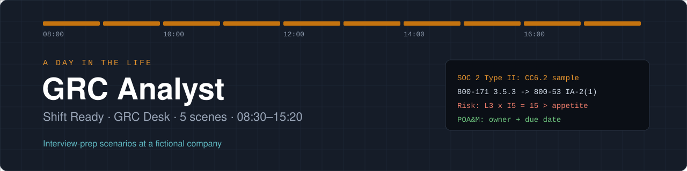

# A Day in the Life: GRC Analyst

  

> Interview-prep scenarios from **Shift Ready**, a scenario-based practice game. Each scene is a realistic moment from a GRC Analyst's shift at a fictional company: the situation, the call I'd make, and why. This is structured practice, not a real incident.

## The shift at a glance

| Time | Scene | Key lesson |
|---|---|---|
| 08:30 | SOC 2 evidence request | Type I asks "is the control designed well on a given date?" Type II asks "did it work over 6 to 12 months?" Type II evidence is samples, timestamps and comparison to a standard. |
| 09:45 | Map one control, many frameworks | 800-171 controls come from 800-53, which is why CMMC work transfers to 800-53, CSF, SOC 2 and ISO conversations. |
| 11:00 | Score a risk | Risk = likelihood x impact, compared to appetite. |
| 13:30 | Vendor security questionnaire | Third-party risk is evidence-driven: trust, then verify. |
| 15:20 | A policy question from Engineering | Good GRC people are seen as helpers, not blockers. |

## Skills practiced

- SOC 2 Type I vs. Type II evidence
- Control crosswalks across NIST 800-171, 800-53, CSF 2.0, SOC 2 and ISO 27001
- Risk scoring and treatment plans
- Evidence-based vendor security reviews
- Policy guidance that enables the business

## Scene by scene

### 08:30 · SOC 2 evidence request

**Situation:** Your company's SOC 2 Type II audit is in progress. The auditor asks for evidence for control CC6.2: "Access is removed when an employee leaves."

**The question:** Which evidence will satisfy a Type II auditor?

**My call:** For a sample of employees who left during the audit period: HR termination date next to the ticket and system log showing when access was removed.

**Why:** Type I asks "is the control designed well on a given date?" Type II asks "did it work over 6 to 12 months?" Type II evidence is samples, timestamps and comparison to a standard.

**How I'd explain it in an interview:** For a Type II I think in samples: pull terminations from the period, match each to the access-removal record, and show the gap stayed inside the standard.

### 09:45 · Map one control, many frameworks

**Situation:** Your manager wants to know how one control satisfies several frameworks at once. I did this kind of crosswalk in my CMMC Level 2 readiness project.

```text
Control: Multi-factor authentication for remote and privileged access

NIST SP 800-171  3.5.3
CMMC Level 2     IA.L2-3.5.3
NIST SP 800-53   IA-2(1), IA-2(2)
NIST CSF 2.0     PR.AA
SOC 2            CC6.1
ISO 27001:2022   Annex A 8.5 (secure authentication)
```

**The question:** Why does a crosswalk like this matter to the business?

**My call:** It lets you test a control once and use the evidence for several audits.

**Why:** 800-171 controls come from 800-53, which is why CMMC work transfers to 800-53, CSF, SOC 2 and ISO conversations.

**How I'd explain it in an interview:** In my self-directed CMMC Level 2 project I mapped controls and gaps against NIST 800-171, which is drawn from 800-53. Crosswalking lets one test produce evidence for several frameworks.

### 11:00 · Score a risk

**Situation:** You're updating the risk register. A finding: backups of the customer database are not encrypted and are stored with a cloud vendor.

```text
Likelihood (1-5): ?
Impact     (1-5): ?
Risk = Likelihood x Impact
Appetite: anything 12 or above needs a treatment plan
```

**The question:** What is a defensible score and next step?

**My call:** L3 x I5 = 15. Above appetite: write a treatment plan (encrypt backups, verify vendor controls) with an owner and a due date, tracked like a POA&M item.

**Why:** Risk = likelihood x impact, compared to appetite. Treatment options: mitigate, transfer, avoid, accept. Every treatment needs an owner and a date. The POA&Ms I drafted in my CMMC readiness project use the same structure.

**How I'd explain it in an interview:** I score likelihood and impact, compare to appetite, and anything over it gets a treatment with an owner and due date, the same way a POA&M tracks remediation.

### 13:30 · Vendor security questionnaire

**Situation:** A new payroll vendor sends back their security questionnaire. Three answers stand out.

```text
Q: Do you have a current SOC 2 Type II report?      A: "In progress"
Q: Is customer data encrypted at rest?                A: "Yes"
Q: Do you use subcontractors with data access?        A: "Occasionally"
```

**The question:** What do you request next?

**My call:** Their SOC 2 readiness timeline or a bridge letter, proof of encryption (or a recent pen test summary), and a list of subprocessors with how they are vetted.

**Why:** Third-party risk is evidence-driven: trust, then verify. Subprocessors (fourth parties) are a common blind spot.

**How I'd explain it in an interview:** In vendor reviews I treat answers as claims until there's evidence: a SOC 2 report or bridge letter, proof of encryption, and a list of subprocessors.

### 15:20 · A policy question from Engineering

**Situation:** An engineer asks if they can store a copy of production customer data on their laptop to debug faster. Policy says production data stays in approved systems.

**The question:** Best response?

**My call:** "Policy doesn't allow production customer data on laptops, but let's find what you need: masked data in the test environment, or a request for an exception reviewed by security."

**Why:** Good GRC people are seen as helpers, not blockers. Explain the why, offer the safe path, and use the exception process when there is a real need.

**How I'd explain it in an interview:** I try to be the person who says 'here's how we can do it safely' instead of just 'no'. Explaining the reason gets better compliance than quoting the policy.

## Reflections

**Which scene surprised you most, and what did it teach you?**

The scene that surprised me most was the framework crosswalk. NIST 800-171 controls come from 800-53, which is why CMMC work carries over to 800-53, CSF, SOC 2 and ISO 27001 conversations. Crosswalking lets one control test produce evidence for several frameworks.

**Pick one scene and explain the right call in your own words, the way you'd say it in an interview.**

A policy question from Engineering.  A good GRC analyst should appreciate the efforts and ingenuity of workers from other departments and help when they can, coming up with alternative ways of achieving the ends that Compliance policies would otherwise block, explaining the reasons for GRC policies, at the very least, rather than merely quoting policies.  The idea is that Compliance Analysts should aim to be helpers instead of blockers.

**How would you use what you practiced here on day one of a real GRC Analyst job?**

On day one of a real GRC Analyst job, I would know Compliance Frameworks and their controls.  Furthermore, I would know how to crosswalk one control test across several other Compliance frameworks, from say, NIST 800-171, which is from 800-53, to CSF, to SOC 2, and to ISO.

## Next steps

- Practice these answers out loud with a 2-minute timer.
- Back each scene with hands-on lab evidence where possible (home lab, Splunk, TryHackMe).
